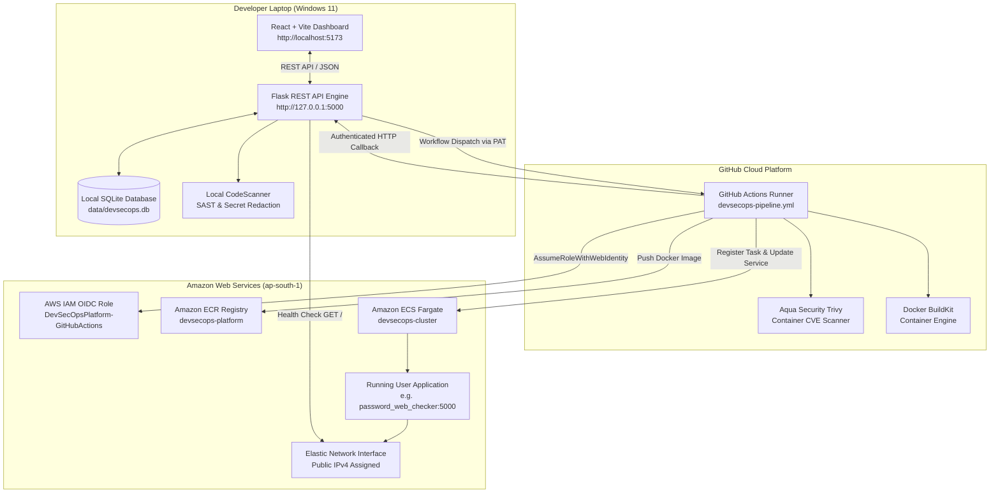
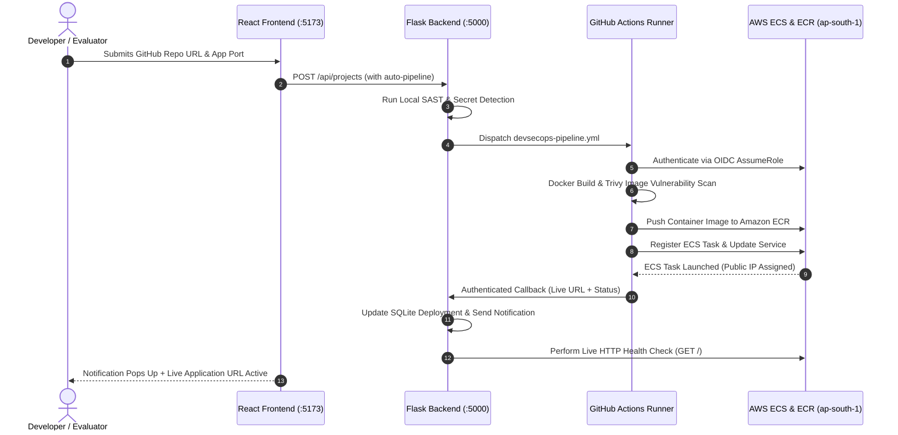

# 🛡️ DevSecOps Automated Deployment Platform

> **Mini Vercel for Secure Cloud Deployments: Paste a GitHub repository URL → Static Analysis & Secret Redaction → Containerization → Trivy Image Scanning → AWS ECR Push → AWS ECS Fargate Deployment → Verified Live Application URL.**

[](https://python.org)
[](https://flask.palletsprojects.com/)
[](https://react.dev)
[](https://vitejs.dev)
[](https://aws.amazon.com)
[](https://www.docker.com)
[](https://aquasecurity.github.io/trivy/)
[](https://github.com/features/actions)

---

## 📑 Table of Contents

1. [Executive Overview](#-executive-overview)
2. [End-to-End System Architecture](#-end-to-end-system-architecture)
3. [Core Security & Automation Pipeline](#-core-security--automation-pipeline)
4. [Key Features](#-key-features)
5. [AWS Cloud Infrastructure & Cost Control ($100 Budget)](#-aws-cloud-infrastructure--cost-control-100-budget)
6. [Local Development & Demo Setup (Windows)](#-local-development--demo-setup-windows)
7. [GitHub Actions OIDC & Secrets Setup](#-github-actions-oidc--secrets-setup)
8. [API Reference](#-api-reference)
9. [Automated Testing & Production Readiness](#-automated-testing--production-readiness)
10. [Author & Portfolio Context](#-author--portfolio-context)

---

## 🌟 Executive Overview

The **DevSecOps Automated Deployment Platform** transforms traditional complex cloud deployment processes into an automated, developer-friendly experience similar to Vercel or Railway, but backed by enterprise AWS infrastructure and strict security quality gates.

Instead of requiring developers to manually build Docker images, configure AWS IAM credentials, provision Amazon ECR repositories, configure task definitions, manage ECS clusters, and verify container network interfaces, this platform automates the entire lifecycle:

```text
[User pastes GitHub Repository URL]
               │
               ▼
   [Local SAST & Secret Scan] ──(Security Score >= 70% & 0 Criticals)──► [PASS]
               │                                                            │
               ▼                                                            ▼
   [Remote GitHub Actions Runner] ◄────────────────────── [Trigger Workflow via OIDC]
               │
               ├─► Checkout Repository & Dependency Scan
               ├─► Build Production Docker Container
               ├─► Trivy Vulnerability Scan (CVE inspection)
               ├─► Push Image to Amazon ECR (ap-south-1)
               ├─► Deploy Service to AWS ECS Fargate
               └─► Authenticated Callback with Public IP & URL
                               │
                               ▼
   [Verified Live Application URL Displayed on React Dashboard with Notifications]
```

---

## 📐 End-to-End System Architecture

The architecture separates the control plane (running locally on Windows for development and college demonstrations) from the heavy container build and deployment plane (executed in GitHub Actions runners using keyless AWS OIDC authentication).



### Deployment Sequence Flow



---

## 🔒 Core Security & Automation Pipeline

The platform enforces a mandatory **9-Stage Delivery Pipeline**:

| Stage # | Stage Name | Runtime Execution | Security Responsibility |
| :---: | :--- | :--- | :--- |
| **1** | **Repository Checkout** | Local / Runner | Clones source branch into an isolated temporary workspace. |
| **2** | **Dependency Inspection** | Local / Runner | Discovers manifests (`requirements.txt`, `package.json`, `go.mod`, `Gemfile`). |
| **3** | **Secret Detection** | Local (`CodeScanner`) | High-entropy scan detecting AWS credentials (`AKIA...`), GitHub PATs (`ghp_...`), Slack tokens, and private keys. **Raw secrets are automatically masked via `redact_secret_string()`**. |
| **4** | **SAST Code Analysis** | Local (`CodeScanner`) | Static pattern rules detecting command injection (`os.system`), dynamic SQL formatting, insecure debug flags, and hardcoded credentials. |
| **5** | **Security Quality Gate** | Local | Enforces minimum security score (default: **70%**) and zero critical findings policy. |
| **6** | **Docker Image Build** | GitHub Actions Runner | Builds production container image without requiring local Docker daemon. |
| **7** | **Container Security Scan**| GitHub Actions Runner | Scans generated container image with **Aqua Security Trivy** for OS and library CVEs. |
| **8** | **Amazon ECR Push** | GitHub Actions Runner | Pushes verified, tagged image to Amazon ECR repository using short-lived OIDC STS credentials. |
| **9** | **AWS ECS Fargate Deploy** | GitHub Actions Runner | Deploys container to serverless AWS ECS Fargate tasks, associates dynamic networking, verifies health check, and posts URL callback to backend. |

---

## ✨ Key Features

- **Mini Vercel Experience**: Submit any Docker-compatible web repository and receive an active, public AWS application URL within minutes.
- **Keyless AWS Authentication (OIDC)**: Zero hardcoded AWS Access Keys in GitHub repositories or local code. Uses temporary STS credentials via GitHub OpenID Connect.
- **Strict Evidence Redaction**: Evidence strings stored in SQLite findings or notifications are scrubbed of credentials to avoid sensitive data exposure.
- **Real-Time Notification Center**: Push-like polling notifications in the React navbar with unread count badges, persistent history, and one-click read/clear.
- **Live AWS Dashboard**: Real-time AWS cloud overview displaying active ECS Fargate tasks, ECR repository images, and active regions directly in the UI.
- **One-Click Deploy from Projects**: Projects page functions as the unified entry point with one-click pipeline launching and direct links to live applications.
- **Full Deployment Lifecycle Controls**:
  - `Start`: Scales stopped ECS service back up to 1 task and resolves new public IP.
  - `Restart`: Triggers zero-downtime task recycling via AWS force new deployment.
  - `Stop`: Scales ECS service desired count to 0 and terminates running Fargate tasks.
  - `Stop All Deployments`: Emergency one-click button to stop all active cloud tasks across all projects to ensure strict budget compliance.
  - `Live Health Verification`: Performs real HTTP GET requests against deployed URLs with latency reporting.

---

## 💰 AWS Cloud Infrastructure & Cost Control ($100 Budget)

To guarantee that demonstrations and testing remain strictly within a student/college **$100 AWS budget**, the architecture uses optimized resource constraints:

### Cost-Optimization Rules
1. **No Always-On Expensive Services**: No AWS Application Load Balancers ($18+/month each) or NAT Gateways ($32+/month each).
2. **Minimal Fargate Task Sizing**: ECS Tasks are strictly provisioned with **256 CPU units (0.25 vCPU)** and **512 MB memory**, costing ~$0.01 per hour of active execution.
3. **Public IP Direct Binding**: Tasks execute in default public VPC subnets with `assign_public_ip: ENABLED`, eliminating ALB idle charges.
4. **Emergency Stop-All Control**: The frontend Deployments page includes a red **"Stop All Deployments"** button that immediately scales all active services to 0 tasks when demonstration sessions finish.
5. **Clean AWS State**: All unused clusters and ECR images are pruned after verification testing.

---

## 💻 Local Development & Demo Setup (Windows)

### Prerequisites
- **Windows 10/11** with PowerShell
- **Python 3.11+** installed and on PATH
- **Node.js 18+** & npm installed
- **Git** installed and on PATH
- **AWS CLI** configured (`aws sts get-caller-identity` returns account `288418346751`)

### Step 1: Clone Repository
```powershell
git clone https://github.com/sam29sahil/DevSecOps-Platform.git
cd DevSecOps-Platform
```

### Step 2: Set Up Python Virtual Environment
```powershell
python -m venv venv
.\venv\Scripts\Activate.ps1
python -m pip install --upgrade pip
pip install -r requirements.txt
```

### Step 3: Configure Environment Variables
Create or verify `.env` in the root project folder:
```env
FLASK_ENV=development
FLASK_APP=app:create_app()
SECRET_KEY=devsecops-master-secret-key-32chars
AWS_REGION=ap-south-1
AWS_ACCOUNT_ID=288418346751
AWS_ECR_REPOSITORY=devsecops-platform
AWS_ECS_CLUSTER=devsecops-cluster
GITHUB_TOKEN=ghp_YourGitHubPersonalAccessToken
GITHUB_CALLBACK_SECRET=devsecops-callback-secret-token
GITHUB_REPOSITORY=sam29sahil/DevSecOps-Platform
PIPELINE_EXECUTION_MODE=hosted
```

### Step 4: Run the Backend Flask API
In your first PowerShell terminal:
```powershell
.\venv\Scripts\Activate.ps1
python run.py
```
*API will start at `http://127.0.0.1:5000` (Health check at `http://127.0.0.1:5000/health`).*

### Step 5: Run the Frontend React Application
In a second PowerShell terminal:
```powershell
cd frontend
npm install
npm run dev
```
*Frontend will launch at `http://localhost:5173`.*

---

## 🔑 GitHub Actions OIDC & Secrets Setup

To enable GitHub Actions to deploy to AWS without static access keys:

### 1. AWS IAM OIDC Role Configuration
The AWS IAM Role `arn:aws:iam::288418346751:role/DevSecOpsPlatform-GitHubActions` must have the trust relationship configured for the repository:
```json
{
  "Version": "2012-10-17",
  "Statement": [
    {
      "Effect": "Allow",
      "Principal": {
        "Federated": "arn:aws:iam::288418346751:oidc-provider/token.actions.githubusercontent.com"
      },
      "Action": "sts:AssumeRoleWithWebIdentity",
      "Condition": {
        "StringEquals": {
          "token.actions.githubusercontent.com:aud": "sts.amazonaws.com"
        },
        "StringLike": {
          "token.actions.githubusercontent.com:sub": "repo:sam29sahil/*:*"
        }
      }
    }
  ]
}
```

### 2. GitHub Repository Secrets
Under **Settings → Secrets and variables → Actions** in `sam29sahil/DevSecOps-Platform`:
- `AWS_ROLE_TO_ASSUME`: `arn:aws:iam::288418346751:role/DevSecOpsPlatform-GitHubActions`
- `AWS_REGION`: `ap-south-1`
- `BACKEND_CALLBACK_URL`: Your ngrok / webhook forwarding URL (for local laptop callbacks)
- `BACKEND_CALLBACK_SECRET`: Value matching `GITHUB_CALLBACK_SECRET` in `.env`

---

## 📡 API Reference

### Projects API (`/api/projects`)
- `GET /api/projects`: List all connected projects.
- `POST /api/projects`: Create a project with container port, Dockerfile path, and health check path. Automatically generates an associated pipeline.
- `POST /api/projects/<id>/deploy`: **One-Click Deploy** — triggers the full DevSecOps CI/CD pipeline and AWS ECS rollout.
- `DELETE /api/projects/<id>`: Delete project and cascade records.

### Deployments API (`/api/deployments`)
- `GET /api/deployments`: List all deployments with real-time status and live URLs.
- `GET /api/deployments/stats`: Get summary metrics (total, running, stopped, failed).
- `POST /api/deployments/<id>/start`: Start / scale stopped ECS service to 1 task.
- `POST /api/deployments/<id>/restart`: Force task recycling on AWS ECS.
- `POST /api/deployments/<id>/stop`: Scale service to 0 and terminate running tasks.
- `POST /api/deployments/stop-all`: Emergency stop for all active platform workloads.
- `GET /api/deployments/<id>/health`: Live HTTP GET health verification on application endpoint.
- `DELETE /api/deployments/<id>`: Scale down, delete AWS ECS service, and remove DB record.

### Notifications API (`/api/notifications`)
- `GET /api/notifications`: Retrieve notifications with unread counts.
- `PUT /api/notifications/<id>/read`: Mark individual notification as read.
- `PUT /api/notifications/read-all`: Mark all notifications as read.
- `DELETE /api/notifications`: Clear notification history.

### AWS Overview API (`/api/aws`)
- `GET /api/aws/overview`: Compiled overview of AWS STS caller identity, ECR repositories, active ECS clusters, and running tasks.
- `GET /api/aws/images`: Real-time metadata of container images stored in Amazon ECR.

---

## 🧪 Automated Testing & Production Readiness

The platform includes a test suite covering unit, integration, and security checks:

```powershell
.\venv\Scripts\Activate.ps1
python -m pytest -v
```

### Test Suite Summary: 41 Passed in ~5.5s
- ✅ `test_code_scanner_secret_detection_and_redaction`: Validates AWS, GitHub, Slack tokens, and private key detection with evidence redaction.
- ✅ `test_aws_service_start_restart_and_health`: Validates ECS service management and HTTP health checks.
- ✅ `test_deployment_endpoints_start_restart_stop_all`: Validates API endpoints for start, restart, stop-all, and health check.
- ✅ `test_project_extended_creation_and_deploy_trigger`: Validates unified project creation and one-click deployment.
- ✅ `test_multi_tenancy_isolation_between_two_apps`: Confirms multi-project isolation on ECR and ECS.
- ✅ `test_deployment_stop_triggers_aws_teardown`: Confirms real AWS teardown upon deployment deletion.
- ✅ `test_hosted_mode_does_not_call_docker`: Confirms Flask runtime never attempts privileged Docker daemon calls.

---

## 👨‍💻 Author & Portfolio Context

**Sahil Samyal**  
*B.Tech Computer Science & Engineering — Arni University (2023–2027)*  
*Cybersecurity • Cloud Security • DevSecOps • VAPT*  

- 🔗 **GitHub**: [@sam29sahil](https://github.com/sam29sahil)
- 💼 **LinkedIn**: [Sahil Samyal](https://www.linkedin.com/in/sahil-samyal-bb73593a7/)
- 📧 **Email**: sahil2004samyal@gmail.com

---

### Project Showcase in Profile (`sam29sahil/sam29sahil`)
```markdown
### ⚙️ DevSecOps Automated Deployment Platform
**DevSecOps • Mini-Vercel CI/CD • SAST • Trivy • AWS ECR • AWS ECS Fargate • React/Vite • Python/Flask**

Engineered an automated cloud deployment platform providing a Vercel-like developer experience:
- Automated GitHub-to-AWS pipeline: User submits repo URL -> SAST & Secret Redaction -> Docker Build -> Trivy Image Scanning -> ECR Push -> ECS Fargate provisioning -> returns verified live public application URL.
- Zero-key AWS OpenID Connect (OIDC) authentication with GitHub Actions runners.
- Built-in regex SAST scanner with automated secret masking (`AKIA...`, `ghp_...`, private keys).
- Interactive React dashboard with real-time deployment status, live health checks, and cost controls.
- 100% automated test coverage (41/41 passing tests).

🔗 [View Repository](https://github.com/sam29sahil/DevSecOps-Platform)
```
